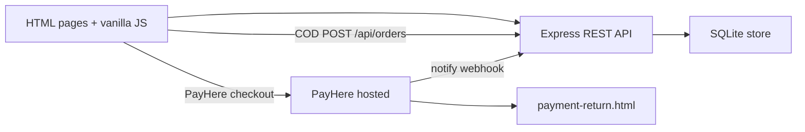

# Peoples Bakers — Full-Stack Bakery E-Commerce

Sri Lankan bakery e-commerce: customers browse products, add to a cart, check out in three steps (cart → details → complete), and pay with **Cash on delivery** or **PayHere**. Staff run orders, products, and feedback from a hidden admin dashboard.

**Author:** [Channa Sandeepa](https://github.com/sandeepa-cpu) · **Repo:** [sandeepa-cpu/Peoples-Bakers](https://github.com/sandeepa-cpu/Peoples-Bakers)

This is a **Node.js + Express** app with **HTML / CSS / vanilla JavaScript** pages (not Next.js / React). A static host such as GitHub Pages will not run it.

---

## What I built

End-to-end product, not a landing-page mock. A reviewer can open these files and see the behaviour.

| Area | What it does | Where to look |
|------|----------------|---------------|
| Multi-step checkout | Shopping cart → billing/payment → order complete; hash restore (`#checkout`, `#checkout-details`, `#checkout-complete`); qty/remove syncs `localStorage` | [`order.html`](order.html), [`js/checkout-page.js`](js/checkout-page.js) |
| Payments | COD in-place success; PayHere hosted POST + MD5 notify webhook; cancel returns to checkout details | [`server/payhere.js`](server/payhere.js), [`payment-return.html`](payment-return.html) |
| REST API | Auth, orders, products, outlets, config, health | [`server/server.js`](server/server.js) |
| Auth | Register / login / logout; JWT in httpOnly cookie; bcrypt passwords; optional Google Sign-In | [`server/auth.js`](server/auth.js) |
| Persistence | SQLite via `node:sqlite` (no separate DB process); prices re-checked on the server | [`server/store.js`](server/store.js) |
| Admin | Orders, products, users, settings, stats (staff URL, not linked from the public nav) | [`server/admin-api.js`](server/admin-api.js), `pb-office.html` |
| i18n | English, Sinhala, Tamil dictionaries | [`js/i18n.js`](js/i18n.js), [`js/translations/`](js/translations/) |
| Home hero | Auto-playing promo carousel (two product banners) | [`js/hero-banner.js`](js/hero-banner.js), [`index.html`](index.html) |
| PWA | Service worker, cache bumping | [`service-worker.js`](service-worker.js) |

**Security choices:** `.env` and `server/data/` are git-ignored; production rejects a weak `JWT_SECRET` and the default admin password; checkout amounts are not trusted from the client; PayHere notify payloads are hash-verified.

---

## Architecture



Customer flow: catalogue → cart (`peoples-bakers-cart-v1`) → checkout steps → COD success on the same page, or PayHere redirect then return.

---

## Tech stack

| Layer | Technology |
|-------|------------|
| Frontend | HTML5, CSS3, vanilla JavaScript |
| Backend | Node.js 22.5+, Express 4 |
| Database | SQLite (`node:sqlite`) |
| Auth | JWT, bcrypt, httpOnly cookies |
| Payments | PayHere (LKR; sandbox supported) |
| Email | Nodemailer (optional SMTP) |
| i18n | JSON dictionaries (`en` / `si` / `ta`) |
| PWA | Service worker |

---

## How to run

```bash
npm install
copy .env.example .env    # Windows — change JWT_SECRET
npm start
```

| URL | Description |
|-----|-------------|
| http://localhost:3000 | Customer site |
| http://localhost:3000/pb-office.html | Admin dashboard |

> **Security Notice:** Production administrative access and live API keys are strictly secured via environment variables (`.env.local`) and authentication policies. No live credentials or default passkeys are stored in this repository.

```bash
npm start              # Server
npm run dev            # Restart on file changes
npm run verify         # Health checks (server must be running)
npm run seed           # Re-seed products
npm run promote-admin -- user@email.com
```

---

## Project structure

```
.
├── index.html, order.html, products.html, cakes.html, …
├── js/checkout-page.js, hero-banner.js, i18n.js, cart.js, …
├── css/style.css
├── server/
│   ├── server.js      # HTTP + REST
│   ├── auth.js
│   ├── store.js
│   ├── admin-api.js
│   ├── payhere.js
│   └── data/          # SQLite — git-ignored
├── js/translations/   # en.json, si.json, ta.json
├── .env.example
└── render.yaml
```

---

## API overview

| Area | Endpoints |
|------|-----------|
| Auth | `POST /api/auth/register`, `login`, `logout`, `GET /api/auth/me` |
| Orders | `POST /api/orders`, `GET /api/orders`, `PATCH /api/orders/:id` |
| Products | `GET /api/products` (+ admin write) |
| Payments | `POST /api/payments/payhere/checkout`, `/notify` |
| Outlets | `GET /api/outlets`, `/nearby`, `/geojson` |
| Admin | `GET /api/admin/stats`, `/orders`, `/users`, `/settings` |
| Config | `GET /api/config`, `GET /api/health` |

Longer notes: [`docs/Peoples-Bakers-Project-Guide-English-Advanced.html`](docs/Peoples-Bakers-Project-Guide-English-Advanced.html)

---

## Environment

Copy `.env.example` to `.env`. **Never commit `.env`.**

| Variable | Purpose |
|----------|---------|
| `JWT_SECRET` | Login token signing (32+ chars in production) |
| `SITE_URL` | Public URL for emails and PayHere |
| `PAYHERE_MERCHANT_ID` / `PAYHERE_MERCHANT_SECRET` | Online payments |
| `PAYHERE_SANDBOX` | `true` while testing |
| `WHATSAPP_NUMBER` | Business WhatsApp |
| `SMTP_*` | Optional order emails |
| `DB_PATH` | Optional SQLite path on the host |

---

## Deployment

Needs **Node.js hosting** (Render, Railway, VPS). GitHub Pages / PHP-only hosts will not work.

- `NODE_ENV=production`, strong `JWT_SECRET`, `ADMIN_SEED_PASSWORD`
- HTTPS for PayHere notify
- Persistent disk for SQLite (`DB_PATH`)

See [`docs/Peoples-Bakers-Hosting-Guide.html`](docs/Peoples-Bakers-Hosting-Guide.html).

---

## License

MIT — Peoples Bakers branding remains with the business.

---

## Contact

- **GitHub:** [@sandeepa-cpu](https://github.com/sandeepa-cpu)
- **Project:** [Peoples-Bakers](https://github.com/sandeepa-cpu/Peoples-Bakers)
- **Email:** channasandep77@gmail.com
